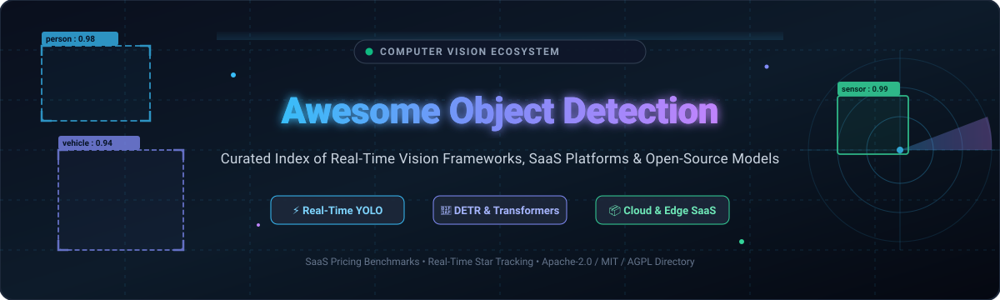

  

# 👁️ Awesome Computer Vision Object Detection 🚀

**Curated List of SaaS Products & Open-Source GitHub Projects**  
*Focused on Visual Detection, Instance Segmentation, Zero-Shot Detection & Real-Time Edge Inference* 🎯  

**Last updated: March 2026** 📅

---

## 📌 Introduction & SEO Highlights 🔍

Welcome to the definitive community index of **Computer Vision Object Detection** tools, open-source repositories, and enterprise SaaS platforms. Object detection algorithms pinpoint, localize (via bounding boxes or segmentation polygons), and classify objects in real-time camera streams, aerial imagery, medical scans, and video archives. 

Whether you are looking to benchmark **real-time detectors** (YOLOv8, YOLOv10, YOLOv11, YOLOv12, RT-DETR), leverage **vision transformers** (DETR, Grounding DINO, Segment Anything SAM), or deploy on enterprise cloud APIs (**AWS Rekognition, Google Cloud Vertex AI Vision, Roboflow, Ultralytics HUB**), this guide indexes the entire landscape with pricing, market capitalization, and star benchmarks.

---

## 📑 Table of Contents

- [🌐 Sector Overview & Market Dynamics](#-sector-overview--market-dynamics)
- [☁️ SaaS & Hosted Platforms](#️-saas--hosted-platforms)
- [💻 Open-Source GitHub Projects](#-open-source-github-projects)
- [🤝 How to Contribute](#-how-to-contribute)
- [💖 Support & Sponsorship](#-support--sponsorship)
- [⚠️ Disclaimer](#️-disclaimer)
- [⭐ Star History](#-star-history)

---

## 🌐 Sector Overview & Market Dynamics

The global computer vision market is estimated at **$22B–$26B in 2026** and is projected to expand to over **$85B by 2033–2035**, exhibiting a compound annual growth rate (**CAGR**) of **15%–19%**. 

The sector features **moderate fragmentation**: while mega-cap hyperscalers (Microsoft, Alphabet, Amazon) dominate managed cloud computing infrastructure, high-performance edge detection and active learning remain widely contestable, powered by innovative specialized startups and vibrant open-source developer ecosystems rather than a single winner-take-all monopoly.

---

## ☁️ SaaS & Hosted Platforms

The table below provides a comprehensive comparison of hosted computer vision and object detection SaaS offerings. It details company scale (valuation or market capitalization), specific starting tier pricing, and exact free tier / free trial limits. Sorted by **Company Size (Market Cap / Valuation) descending**.

| 🏷️ Product | 🏢 Company Scale (Valuation / Revenue) | 💵 Starting Tier Pricing | 🎁 Free Tier / Free Trial Limits | 📝 Description |
| :--- | :--- | :--- | :--- | :--- |
| **[Azure Custom Vision](https://azure.microsoft.com/en-us/products/ai-services/ai-vision)** | Microsoft (~$3.1T Market Cap) | Pay-as-you-go starting at $2.00 per 1,000 transactions; Training at $20.00 per compute hour | **Free F0 Tier:** 2 projects, 5,000 training images per project, 1 hour training time/month, and 10,000 prediction transactions/month. | Prebuilt and custom vision models for classification and bounding-box object detection integrated with Azure cognitive services. |
| **[AWS Rekognition](https://aws.amazon.com/rekognition/)** | Amazon (~$1.9T Market Cap) | Custom Labels starting at $4.00/hour for training + $4.00/hour for inference; Standard detection at $1.00 per 1,000 images | **AWS Free Tier (12 Months):** 5,000 images/month for standard image analysis; Custom Labels includes 10 free training hours and 4 free inference hours/month for the first 3 months. | Scalable computer vision service offering object, scene, text, and facial detection, plus Custom Labels training. |
| **[Google Cloud Vertex AI Vision](https://cloud.google.com/vertex-ai)** | Alphabet (~$1.8T Market Cap) | Vision Warehouse storage at $0.0033/GB-month; Streaming video analytics starting at $0.10 per stream-hour | **GCP Free Tier:** $300 free credits across 90-day trial for new accounts; Vertex AI includes 1,000 free operations/month for general vision APIs. | End-to-end computer vision platform designed for scalable video ingestion, vision pipelines, occupancy analysis, and real-time detection. |
| **[Salesforce Einstein Object Detection](https://developer.salesforce.com/)** | Salesforce (~$280B Market Cap) | Platform service bundled within Einstein 1 Platform editions starting at $50/user/month (Enterprise tier) | **Salesforce Developer Edition Free Tier:** Free developer account with 2,000 lifetime Einstein Platform prediction calls and access to testing sandbox. *(Service retired for new standalone SKUs Summer '23).* | Visual detection service trained on annotated bounding boxes (`annotations.csv`) for retail share-of-shelf and inventory audits. |
| **[Clarifai](https://www.clarifai.com/)** | ~$1.0B Valuation (Series C) | Essential Plan starting at $30/month (includes credit allocation); Professional Plan at $300/month | **Community Free Plan:** 1,000 free operations/month, free access to public pre-trained models and workflow builder. | Full-lifecycle computer vision and multimodal AI platform with custom model training and automated labeling. |
| **[SuperAnnotate](https://www.superannotate.com/)** | ~$250M Valuation (Series B) | Starter plan starting at $150/month (billed annually) for team workspaces | **Free Forever Plan:** Up to 3 users, 5,000 dataset items, full image/video bounding box and polygon annotation tools. Dedicated 14-day Enterprise pilot on request. | Enterprise training data platform with AI-assisted labeling, QA workflows, vector search, and Python SDK integration. |
| **[LandingLens](https://landing.ai/)** | ~$150M Valuation (Series A) | Self-serve Team plan starting at $250/month (includes compute inference quotas) | **Free Plan:** 1,000 credits/month, up to 10,000 images per project, unlimited projects/classes, 3 invited collaborators (1 model export download for non-commercial evaluation). | Data-centric computer vision platform founded by Andrew Ng, specializing in industrial inspection and defect detection. |
| **[Roboflow](https://roboflow.com/)** | ~$100M Valuation (Series A) | Core Plan starting at $39/month (flexible credit packs for scale) | **Free Forever Plan:** 10 credits/month (~30 cloud trainings, 10,000 auto-labeled images with SAM, or 80,000 cloud inferences), unlimited private datasets, full export capabilities. | Developer-first platform for dataset collection, automated labeling, format conversion, and multi-model deployment. |
| **[Supervisely](https://supervisely.com/)** | ~$50M Valuation (Growth Stage) | Pro Edition starting at €199/month (approx. $215/month) | **Community Edition Free:** Free access for personal/open-source use, up to 10,000 images/videos, standard tracking algorithms, community app ecosystem. | Modular OS for computer vision featuring video tracking, 3D LiDAR point cloud labeling, and custom deep learning app integrations. |
| **[Ultralytics HUB](https://hub.ultralytics.com/)** | High-growth CV Bootstrapped / SaaS (~$30M+ Val.) | Pro Plan starting at $29/seat/month (includes $30 monthly compute credits, 500 models, 500 GB storage) | **Free Plan:** $0/month, includes $5 starting credit ($25 with corporate email), up to 100 models, 3 concurrent trainings, and 100 GB storage. | No-code web platform for training, optimizing, and deploying YOLOv5, YOLOv8, and YOLO11 models on cloud GPU nodes. |

---

## 💻 Open-Source GitHub Projects

Curated list of the top open-source repositories for model training, inference engines, dataset management, and annotation. Each project includes a real-time GitHub stargazer badge linking to its stargazers page. Sorted by **GitHub Stars descending**.

1. **[OpenCV](https://github.com/opencv/opencv)**   
   The industry-standard open-source computer vision library (Apache-2.0). Features the highly optimized DNN module supporting real-time inference for YOLO, MobileNet-SSD, and Faster R-CNN on CPU, CUDA, and OpenVINO backends.

2. **[TensorFlow Models](https://github.com/tensorflow/models)**   
   Official TensorFlow repository (Apache-2.0) featuring the TensorFlow Object Detection API. Provides implementations of Faster R-CNN, SSD, EfficientDet, and Mask R-CNN with quantization and export utilities for Edge TPU and TFLite.

3. **[Ultralytics YOLO](https://github.com/ultralytics/ultralytics)**   
   The premier real-time computer vision framework (AGPL-3.0). Powers YOLOv8, YOLO11, and YOLO12 architectures supporting object detection, instance segmentation, oriented bounding boxes (OBB), pose estimation, and classification.

4. **[YOLOv5](https://github.com/ultralytics/yolov5)**   
   Ultralytics' foundational PyTorch implementation (AGPL-3.0). Celebrated for its intuitive training pipelines, auto-anchor calculation, seamless ONNX/TensorRT export, and robust mobile integration.

5. **[Segment Anything (SAM)](https://github.com/facebookresearch/segment-anything)**   
   Meta AI's foundation model for zero-shot image segmentation (Apache-2.0). Can be paired with bounding box detectors to achieve instant, high-precision instance segmentation masks.

6. **[Detectron2](https://github.com/facebookresearch/detectron2)**   
   FAIR's next-generation modular framework (Apache-2.0). Implements state-of-the-art detection algorithms including Faster R-CNN, Mask R-CNN, RetinaNet, DensePose, and PointRend with PyTorch.

7. **[MMDetection](https://github.com/open-mmlab/mmdetection)**   
   OpenMMLab's flagship object detection toolbox (Apache-2.0). Contains hundreds of pre-trained models across single-stage, two-stage, multi-stage, anchor-free, and transformer-based detection architectures.

8. **[Label Studio](https://github.com/HumanSignal/label-studio)**   
   Multi-domain data labeling software (Apache-2.0). Supports image bounding boxes, semantic polygons, video tracking labels, and audio/text annotations with active learning webhooks.

9. **[Darknet](https://github.com/AlexeyAB/darknet)**   
   The iconic C/CUDA neural network framework (YOLOv4 / AlexeyAB fork). Extremely lightweight with zero heavy dependencies, engineered for real-time low-power embedded inference.

10. **[TorchVision](https://github.com/pytorch/vision)**   
    Official PyTorch CV package (BSD-3-Clause). Includes battle-tested implementations of Faster R-CNN, Mask R-CNN, SSD, RetinaNet, and FCOS with standard TorchScript deployment paths.

11. **[CVAT](https://github.com/cvat-ai/cvat)**   
    Computer Vision Annotation Tool (MIT). Powerful web-based annotation engine for image and video sequences, featuring automatic interpolation, AI tracker integration, and team management.

12. **[DETR (DEtection TRansformer)](https://github.com/facebookresearch/detr)**   
    Meta AI's groundbreaking architecture (Apache-2.0) that eliminated hand-crafted components like NMS (Non-Maximum Suppression) and anchor generators, introducing end-to-end transformers to visual object detection.

13. **[PaddleDetection](https://github.com/PaddlePaddle/PaddleDetection)**   
    Baidu PaddlePaddle's end-to-end detection toolkit (Apache-2.0). Covers PP-YOLOE, RT-DETR, multi-object tracking, and small object detection with high-speed inference on edge chips.

14. **[YOLOv7](https://github.com/WongKinYiu/yolov7)**   
    Trainable bag-of-freebies real-time detector (GPL-3.0) by WongKinYiu. Introduces Extended-ELAN (E-ELAN) architecture and model scaling for high-accuracy inference.

15. **[YOLOv10](https://github.com/THU-MIG/yolov10)**   
    Real-time end-to-end object detector (AGPL-3.0) from Tsinghua University. Utilizes dual label assignments for NMS-free training, achieving ultra-low inference latency.

16. **[FiftyOne](https://github.com/voxel51/fiftyone)**   
    Open-source visual AI dataset curation tool (Apache-2.0). Provides interactive visualization, error analysis, detection false positive detection, and vector search embeddings.

17. **[Grounding DINO](https://github.com/IDEA-Research/GroundingDINO)**   
    Leading open-world zero-shot object detector (Apache-2.0). Couples language grounding with the DINO transformer detector to detect arbitrary objects using arbitrary natural language prompts.

18. **[YOLOv3](https://github.com/ultralytics/yolov3)**   
    Ultralytics' PyTorch implementation (GPL-3.0) of Joseph Redmon's historic YOLOv3 architecture. Serves as a standard educational and reference implementation.

19. **[YOLOv9](https://github.com/WongKinYiu/yolov9)**   
    Programmable gradient information (PGI) and GELAN architecture (GPL-3.0). Mitigates deep network information bottleneck for real-time bounding box prediction.

20. **[MMPose](https://github.com/open-mmlab/mmpose)**   
    OpenMMLab pose estimation toolbox (Apache-2.0). Works alongside detection models to detect multi-person keypoints, whole-body landmarks, and gesture structures.

21. **[MMDetection3D](https://github.com/open-mmlab/mmdetection3d)**   
    Next-generation platform for 3D perception (Apache-2.0). Supports LiDAR, monocular camera, and multi-view point cloud detection architectures (CenterPoint, PointPillars, PV-RCNN).

22. **[YOLOv6](https://github.com/meituan/YOLOv6)**   
    Meituan's industrial-grade real-time detector (GPL-3.0). Built with reparameterized backbones (RepVGG/EfficientRep) and anchor-aided training for production delivery.

23. **[RT-DETR](https://github.com/lyuwenyu/RT-DETR)**   
    Real-Time DEtection TRansformer (Apache-2.0). Surpasses YOLO architectures in both latency and accuracy using multi-scale cross-attention feature interactions.

24. **[SAHI (Slicing Aided Hyper Inference)](https://github.com/obss/sahi)**   
    Framework for small object detection via slicing and tiled inference (MIT). Seamlessly patches into YOLO, MMDetection, and Detectron2 for high-resolution satellite, drone, and aerial imaging.

25. **[SuperGradients](https://github.com/Deci-AI/super-gradients)**   
    PyTorch-based training library (Apache-2.0) by Deci AI. Home to the YOLO-NAS (Neural Architecture Search) model family engineered for high throughput and hardware optimization.

26. **[MMYOLO](https://github.com/open-mmlab/mmyolo)**   
    OpenMMLab's unified YOLO toolbox (Apache-2.0). Provides standardized benchmarks, training pipelines, and deployment recipes for YOLOv5, YOLOv6, YOLOv7, YOLOv8, and RTMDet.

27. **[DINO](https://github.com/IDEA-Research/DINO)**   
    DETR with Improved DeNoising Anchor Boxes (Apache-2.0). State-of-the-art end-to-end transformer detector with contrastive denoising and dynamic query selection.

---

## 🛠️ Stack Assembly Guide 💡

To build an end-to-end, cost-effective, self-hosted object detection pipeline:
- **Annotation & Labeling:** Use [CVAT](https://github.com/cvat-ai/cvat) or [Label Studio](https://github.com/HumanSignal/label-studio) with AI-assisted bounding boxes.
- **Dataset Curation & Debugging:** Use [FiftyOne](https://github.com/voxel51/fiftyone) to clean annotation false positives and visualize edge cases.
- **Model Training:** Train real-time models with [Ultralytics](https://github.com/ultralytics/ultralytics), [RT-DETR](https://github.com/lyuwenyu/RT-DETR), or [MMDetection](https://github.com/open-mmlab/mmdetection).
- **Small-Object Boosting:** Wrap inference with [SAHI](https://github.com/obss/sahi) to detect tiny targets in 4K aerial/drone imagery.
- **High-Throughput Serving:** Export weights to ONNX or TensorRT and serve with [OpenCV DNN](https://github.com/opencv/opencv) or Triton Inference Server.

---

## 🤝 How to Contribute

Contributions are warmly welcomed! 🌟
1. **Fork** the repository.
2. Create a descriptive feature branch (`git checkout -b feature/add-new-detector`).
3. Add your entry following the established table or list format with verified official links.
4. Open a **Pull Request** explaining the tool's significance to the computer vision community.

---

## 💖 Support & Sponsorship

If you find this curated computer vision guide useful, please consider supporting the project:
- ⭐ **Star** this repository on GitHub to help others discover it!
- 🍴 **Fork** and share it across your team, university lab, or social networks.
- ☕ **Buy me a coffee / Sponsor:** Support ongoing maintenance, benchmarks, and updates via the [GitHub Sponsor Dashboard](https://github.com/sponsors/ishandutta2007).

Thank you to all community contributors, researchers, and maintainers! 🙌

---

## ⚠️ Disclaimer

- This list is **community-curated** for educational, engineering, and architectural reference — inclusion does not constitute commercial endorsement.
- Ensure that computer vision, facial recognition, and surveillance deployments strictly adhere to relevant data protection, consent, and privacy regulations (GDPR, CCPA, BIPA).
- Cloud pricing figures and star counters reflect verified metrics as of early 2026 and are subject to vendor updates.

---

##  Star History

